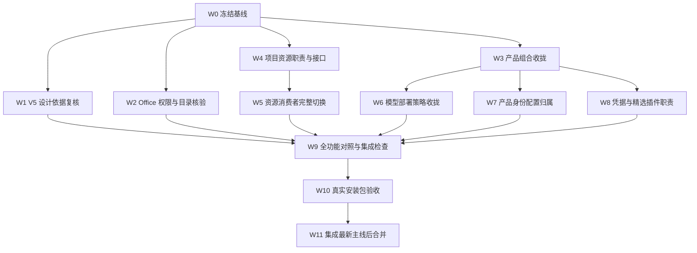

# AsterHub 架构收拢重构实施计划

> 执行要求：按工作包逐项实施并审查；执行阶段使用 `executing-plans` 或 `subagent-driven-development` 工作流。本文件是待执行计划，不代表重构、功能测试或合并已经完成。

**目标：** 在保留现有产品功能、账户模型接入、安全限制和历史数据的前提下，收拢 AsterHub 产品组合及具体实现依赖，减少长期维护的 DSH 基座差异。

**架构：** 保留 DSH 执行骨架与 Cordis 扩展机制；由 AsterHub 产品组合拥有专属默认值，由能力 provider 拥有实现，由通用服务提供必要的执行与约束接口。Electron 继续拥有窗口、系统桥接、运行时资源、安装和更新，不以移动目录代替解耦。

**技术栈：** TypeScript ESM、Cordis、React、Electron、JSONL/Zstandard Session、Neo4j、MCP、Vitest、现有 profile/bundle/overlay 与桌面打包链。

**设计依据：** [项目架构盘点与收拢建议](项目架构盘点与收拢建议.md)、[架构](docs/architecture.zh.md)、[测试策略](docs/testing.zh.md)、[项目历史设计](docs/superpowers/specs/2026-10-07-project-local-history-design.zh.md)。本计划替代原盘点中的执行排序；原盘点继续保留审计范围与历史观测。

## 摘要

重构采用独立分支 `refactor/architecture-consolidation`，工作区为仓库内 `.worktrees/architecture-consolidation/`。主目录继续保留当前代码和未提交工作。先冻结可复现基线，再按产品组合、项目资源、模型策略及产品身份分批切换；每批交付完整的服务定义、实现和消费者，不保留双实现或临时兼容壳。最终以同一环境下的功能对照、真实 Electron 验收、打包运行时检查和数据兼容证据决定能否合并，不以编译成功或单测通过代替产品等价。

Session V5 和 Office 分别处理持久化设计依据、文件访问与目录正确性；两者不是预设必须重构的结论，也不自动阻塞无依赖的产品组合工作。全部必需验收通过、最终候选与最新主线重新集成验证、人工复核完成后，才能合并到 `master`；替换采用 Git 合并，不覆盖复制主目录。

## 目录

- [一、范围与不可退化约束](#一范围与不可退化约束)
- [二、隔离工作区与基线冻结](#二隔离工作区与基线冻结)
- [三、工作包依赖](#三工作包依赖)
- [四、逐项实施工作包](#四逐项实施工作包)
- [五、功能等价验收矩阵](#五功能等价验收矩阵)
- [六、验证命令与证据要求](#六验证命令与证据要求)
- [七、合并与故障恢复](#七合并与故障恢复)
- [八、执行记录与完成判定](#八执行记录与完成判定)

## 一、范围与不可退化约束

### 1.1 本次范围

本次收拢包括共享组合中的 AsterHub 默认值、项目存储与附件消费者、模型部署约束中的产品知识、系统身份默认值，以及凭据、精选插件和 Office 的责任划分。每项改动必须说明删除了什么重复配置、特殊分支、直接实现依赖或升级适配义务；单纯换包名、搬目录和增加转发层不构成完成。

原盘点是关键能力清单，不是全部功能清单。工作包 W0 必须补齐当前发行版本中其他可见能力及支持平台；第五节矩阵是必检下限，不得据此缩减现有产品范围。

### 1.2 不可退化约束

- 保留 Anima、本地 Neo4j、已有记忆与人格数据；不更换数据库，不自动重建或清空图。
- 保留账户登录、积分与用量、充值入口、账户凭据持有方式，以及受控模型目录。
- 供应商、接入地址、凭据来源由应用控制；用户只能选择当前账户可用模型。聊天、辅助请求、子代理、Workflow 和直接调用均不得绕过执行层约束。
- 保留项目 `.aster` 中的会话和原始附件，以及全局 `.asterhub` 中的账户、机器配置和定位信息。用户显式设置的 `DSH_HOME` 不得被覆盖。
- 不修改已提交 Session 的身份、创建目录、父子关系、事件序号、继承截点或历史世代；不把 V5 常量降回 V4，不覆盖已接受的持久化声明、schema 与 checkpoint。
- 项目移动后的执行目录取当前验证过的项目绑定；历史 `SessionHeader.cwd` 保持不变。项目缺失、离线或只读时，不静默回退到全局目录或其他项目写入。
- 保留附件会话归属、跨会话访问拒绝、原图回放、fork 和子代理的既有授权规则；不能以接口收窄为由取消检查。
- 保留文件权限、沙箱、工具审批、账户鉴权、精选插件签名校验及取消和退出清理。工作目录、realpath 和工具列表过滤均不能替代访问授权。
- 保留桌面浏览器、自动化、语音、Office、插件安装、离线运行时、安装更新和恢复流程；Web 验证不代替 Electron 验证。
- 应用继续通过已有 `dsh` profile 启动，不新增绕过 profile runner 的产品入口，不复制 Agent 循环。
- 预稳定 API 改动迁移所有消费者；删除被本次切换淘汰的实现、别名和配置路径，不保留双写或长期兼容壳。已发布数据兼容链不属于可删除的旧代码。

### 1.3 明确不做

不顺手升级 DSH 基座、模型 SDK、Neo4j、Electron 或发行版本；不重新设计 UI、不更换支付和搜索服务、不调整商业策略、不修改签名与发布策略。发现相关缺陷时单列原因和影响，先判断是否由本次改动引入，不混入架构整理。

## 二、隔离工作区与基线冻结

### 2.1 主目录保护

起草计划时，本地 `master` 已包含项目图片附件 scope 修复提交；当时还有会话控制器 Host 路径校验、Client 测试及交接/架构文档的未提交修改。用户要求将这些工作区变更完整提交后，再建立重构分支。重构工作区应从该提交后的 HEAD 创建；W0 记录精确基线，并将上述修复作为基线行为，不得误认作重构差异或重置掉。

W0 完成前不开始生产重构。工作区创建只代表隔离位置就绪，不代表已经取得完整功能基线；执行者须在隔离工作区按本计划重建基线、核对产品版本与测试结果。任何新出现的未提交变更先由其拥有者归类；不得以干净 HEAD 悄悄代替用户要求保持的版本。

### 2.2 分支与工作区

分支名固定为 `refactor/architecture-consolidation`；工作区固定为 `.worktrees/architecture-consolidation/`。创建前检查同名分支、同路径和 `.worktrees/` 的 Git 忽略规则；已存在时先核对归属，不删除或重建现有工作区。

```sh
git status --short --branch
git worktree list
git check-ignore .worktrees/architecture-consolidation
git branch --list refactor/architecture-consolidation
```

仅在分支和工作区均未存在时执行一次：

```sh
git worktree add .worktrees/architecture-consolidation -b refactor/architecture-consolidation HEAD
```

不共享可写 `node_modules`、构建输出、profile、凭据目录或数据库。依赖在隔离工作区按 lockfile 安装；安装前检查空间、Node/pnpm 版本和构建条件，不借修复环境之名重装主目录依赖。测试 home、Electron userData、项目根、端口与 Neo4j 数据目录全部隔离。

### 2.3 基线与证据位置

在重构工作区使用 Git 忽略的 `.local-workspace/architecture-consolidation/` 保存执行证据，不将密钥、账户 token、原始用户会话或数据库副本提交到仓库。记录文件包括 `baseline.json`、`differences.json`、`acceptance.json`、`commands.jsonl` 和 `artifacts.json`；这些是执行记录，不是另一个配置或运行时实现。

`baseline.json` 至少记录源提交、纳入的基线修复提交、主目录待处理变化摘要、桌面产品版本、DSH 运行时版本、lockfile 摘要、操作系统、Node/pnpm/Electron 版本、支持平台、构建参数，以及受控配置的脱敏摘要。已安装应用、当前已提交源码与当前未提交源码必须分别标识，不混称同一版本。

对照运行使用由同一冻结源码构建的基线安装包和最终候选；相同机器条件、测试数据、账户权限与服务配置下执行同一套输入。基线测试通过才能成为正向对照。已确认的基线缺陷保留单独缺陷记录：候选不能新增缺陷，也不能把修复后的行为冒充逐字相同。

## 三、工作包依赖

W0 是所有生产改动的共同前提。W1、W2 与 W3 可以由不同负责人开展，但共享文件只能有一个编辑拥有者。W4 先冻结必要接口，W5 才迁移消费者；W6 等待 W3 的产品策略归属确定。W9 汇总功能证据，W10 验证精确候选产物，W11 才集成主线。



每个工作包按“补充缺失的消费者行为用例并观察修复前结果 → 最小完整改动 → 定向测试 → 实际入口 smoke → 独立审查 → 提交”的循环执行。调查包以证据与决策完成，不强行产生代码。已有测试足够时不重复造测试；不新增只断言配置拷贝、调用转发或固定字符串的测试，不通过放宽断言、增加跳过或刷新错误快照来消除失败。

## 四、逐项实施工作包

### W0：冻结功能、源码和环境基线

**产物：** 可重建的基线源码和安装包、完整功能清单、基线问题清单、脱敏环境记录、每项验收的负责人及所需环境。

**文件与入口：** 根 `package.json`、`pnpm-lock.yaml`、[桌面说明](apps/desktop/README.zh.md)、[测试策略](docs/testing.zh.md)，以及当前基线中的 `packages/api/session-controller/src/commands.ts`、`src/index.ts` 和 `tests/`；这些文件是已交付能力与缺陷修复的基线，不是架构重构的待改目标。

- [ ] 核对主目录未提交变化，完成第二节的归属处理；检查重构分支已包含所有应保留的基线修复。
- [ ] 从 profile、插件菜单、设置页、桌面菜单与安装包功能补全第五节矩阵；为每项确定自动化测试、实际入口、正向与拒绝用例。
- [ ] 使用临时项目和独立 home 生成含文字、原始图片、文件、fork、子代理和历史格式的合法测试数据，记录可重复输入和外部可观察结果。
- [ ] 对基线执行已有相关测试、真实模型与服务 smoke、Electron 走查及打包运行时验证；缺少账户、服务、设备或平台时记录阻塞，不记为通过。
- [ ] 冻结基线标识和产物摘要；给差异台账建立四类：上游回移、通用修复、必要扩展、业务定制。每项写明拥有者、消费者、拟消除的维护义务和保留理由。

**退出条件：** 基线可重建，矩阵完整，全部待保留变更归属明确；没有使用真实用户数据，也没有把历史测试记录当成本轮结果。

### W1：复核 V5 类型演进依据，不回退格式

**产物：** 持久化变化逐根对照、Anima 设计必要性判断，以及“保持现状并补充依据”或“另立向前演进变更”的结论。

**文件：** [持久化兼容规则](docs/persistence-changes/README.zh.md)、[格式状态](docs/session-format-status.zh.md)、`docs/persistence-changes/2026-10-18-anima-session-v5.schema.json` 及声明中每个根的前驱快照、`packages/core/session/src/types.ts`、`packages/session/session-format-v4-to-v5/src/migration.ts`、Anima 的来源类型与持久事件定义。

**已核实前提：** 仓库现有分类器对 V5 与其指定前驱快照的共有事件根进行比较，已将 `agent/inbox/spliced`、`developer/message`、`user/message`、`session/title-llm-request` 判为要求升级版本。前三项包含 Anima 来源联合类型扩展。复用 V4 物理编码不等于没有逻辑类型变化；新增普通 extraction 事件也不能解释或否定整批变更。

- [ ] 按 V5 声明中的 `previous` 逐根选择前驱；`SessionHeader` 使用它自己的前驱，不能用缺少该根的局部快照制造“新增 header”结果。
- [ ] 使用现有只读比较器核对类型分类；逐项解释来源类型、消息联合类型、普通事件与 header 版本变化，区分必要变化与传递性摘要变化。
- [ ] 检查 Anima 是否需要影响既有来源语义；只有在保留回放、模型可见记录及归属要求的前提下，才评估已有兼容扩展机制。不得为避免版本升级伪造兼容声明。
- [ ] 执行 `packages/session/session-format-v4-to-v5/tests/migration.spec.ts` 和涉及 Anima 的记录回放；确认事件、流、继承截点与旧世代未被重写。
- [ ] 在可编辑的说明中补充具体依据；已接受的机器声明、schema、checkpoint 与历史代际保持不变。确需新持久化语义时，另建后继记录并遵循现有流程，不混入接口搬迁。

**退出条件：** 每个变更根都有分类依据和语义说明；数据可读性有运行证据。无真实兼容缺陷时，本包不要求生产代码变更，也不阻塞 W3。

### W2：核验 Office 文件访问、审批与项目目录

**产物：** 实际调用链的允许与拒绝证据；发现缺陷时提供独立最小修复，不以整个 Office 重写作为前提。

**文件：** `services/asterhub-catalog/packages/genoffice-cli/index.mjs`、其实际分发的 CLI 资源、MCP 工具定义与审批路径、`packages/skill/skill-office/`、`packages/document/office-to-pdf/`、桌面 Office engine 解析及 runtime smoke。具体 CLI 资源与审批消费者在本包沿实际入口确定，不只审计桥接文件。

**已核实前提：** 直接执行当前桥接的 `sessionRoot()`，在历史目录存在时会优先选择历史 cwd；历史目录缺失时会落到 profile 目录，而不是重新尝试当前运行目录。这是函数级证据，不是完整桌面读写或越权证据。

- [ ] 沿 `createMcpToolDefinition`、工具执行与 MCP 子进程链确认谁实施审批、文件限制、只读策略、取消和退出清理；记录环境变量的来源，不从变量名推断保护存在。
- [ ] 使用自有临时目录执行：允许根内读写、允许根外读写、相对路径逃逸、符号链接和 Windows junction 指向根外、只读目录、审批拒绝、调用取消及进程退出。
- [ ] 分别保留和移除旧项目目录，打开迁移后的项目调用真实 Office 工具；以文件实际落点证明使用当前项目，旧目录和 profile 目录无意外写入。
- [ ] 若目录问题在真实路径复现，先添加覆盖该调用路径的回归，再复用当前可信项目执行目录解析；不得改写历史 cwd，不新增静默目录回退。
- [ ] 若发现权限缺口，在真正执行边界接入已有权限机制；同时证明合法读写仍能完成，不用工具名称白名单或隐藏入口替代限制。

**退出条件：** 正向创作、读取与转换不退化，拒绝与取消有外部状态证据；无法运行的场景明确阻塞本项验收，不宣称与 DSH 沙箱等价。

### W3：由独立产品组合拥有 AsterHub 默认值

**产物：** 一处产品默认值来源，完整的受支持 profile 与桌面运行时装配，不改变账户和模型约束。

**现有文件：** `packages/bundle/base/cordis.patch.yml`、`packages/bundle/web-app/cordis.patch.yml`、`packages/bundle/asterhub-desktop-native/cordis.patch.yml`、各 profile 清单、桌面 profile 初始化、dev/runtime 元数据与生产包依赖。新增产品 bundle 的目录、包名和 patch 归属在本包接口审查时一并确定，不能先创建空包占位。

- [ ] 冻结 profile 行为表：Desktop 保留完整产品能力；普通 Web 是否属于同一产品支持面必须有明确记录；headless、SDK、ACP 的基线能力不得因默认值移出而无声丢失。通用 profile 不再隐含私有服务，受支持的产品自动化入口则显式叠加产品组合。
- [ ] 逐项迁移账户与模型路由、私有搜索、Anima、项目存储与附件策略、语音、精选插件、产品预设和技能等产品默认值；不要把通用服务实现全部搬走。
- [ ] 产品共享能力与 Desktop-only native bundle 分开：普通 Web 不挂载 Electron transport；需要 native 的组合必须显式声明，不以服务缺失静默跳过。
- [ ] 同时更新包清单、lockfile、profile resolver、桌面开发启动、运行时元数据和打包依赖；检查 patch 替换整段 config、row id、包名及加载顺序，避免后层覆盖使路由锁或项目附件策略失效。
- [ ] 从真实 profile 启动观察有效组合，完成登录、选模型、文字与图片连续请求、记忆、搜索、Office、浏览器及自动化入口 smoke；卸载可选产品功能后，约定的基础组合仍可启动。
- [ ] 删除共享层原产品默认行和重复来源；复用已有组合检查，不新增只验证“配置复制到了新文件”的测试。每个有行为变化的消费者补对应快照或真实入口证据。

**退出条件：** 产品默认值有唯一拥有者，所有支持入口行为明确；构建产物包含完整依赖，Desktop 约束未退化，通用组合不访问私有服务。

### W4：冻结项目资源的最小职责划分

**产物：** 由真实消费者推动的窄接口决策和文件拥有者表；不交付空服务或只有转发的抽象。

**现有定义：** `packages/attachment/attachment/src/index.ts` 中的 `AttachmentStore`、`packages/attachment/attachment/src/types.ts` 中的 `AttachmentScope`、`packages/workspace/workspace/src/index.ts` 中的 `ProjectStorageLocator`，以及 `packages/workspace/project-storage/src/index.ts` 的位置、当前 cwd 与删除能力。

- [ ] 逐项列出消费者所需信息：执行目录、会话存在与归属、附件访问、删除与注销；不能把它们简单合并为一个“大存储接口”。
- [ ] 优先复用现有 `ctx.attachments` 等服务，使模型适配器只请求附件能力，不获知 `.aster` 布局、定位器或 `projectStorage` 的存在。
- [ ] 分开可信会话身份解析、附件归属和文件访问授权；项目标识必须来自已验证的会话，不采信模型或客户端直接提交的目录和 projectId。
- [ ] 删除操作保留原有活跃 agent 停止、持久化关闭、删除和通知顺序；当前 cwd 解析保留缺失、只读、离线及重新绑定的区别。
- [ ] 在设计审查中冻结每项接口的声明位置、参数与返回值、无归属语义、错误、取消、生命周期及 provider；只有多个真实消费者确需共同能力时才新增服务定义包。新包必须同时交付 provider、消费者和完整测试。

**退出条件：** W5 能据冻结的接口逐调用方迁移；减少对具体实现的认识，且不增加第二套可写元数据或模糊的 undefined 回退。

### W5：完整迁移项目资源与附件消费者

**产物：** 通用消费者不再直接依赖具体项目存储实现；项目移动、原始附件与会话删除保持原有保护。

**文件：** `packages/workspace/project-storage/`、`packages/workspace/workspace/`、`packages/attachment/attachment-local/`、`packages/api/session-controller/`、`packages/llm/llm-pi-ai/` 及另一 LLM adapter，所有图片生产入口和既有项目作用域解析消费者。

- [ ] 使用 LSP references 枚举待改导出符号的调用方，另按持久事件、工具和跨进程入口排查动态消费者；同次迁移源码、公开导出、类型、README 和生成引用。
- [ ] 先切换会话位置与当前执行目录，再切换附件 scope 解析和读写；每一批保持可运行，不制造必须靠后续工作补全的半套接口。
- [ ] 覆盖会话上传、队列编辑、浏览器截图、文件图片工具、MCP 图片结果、ACP 和子代理等实际图片生产者；图像字节必须在目的 Session 的存储作用域内落盘。
- [ ] 覆盖首次图片请求、下一轮文字重放图片、重启后重放、fork 与子代理授权、跨会话拒绝、项目复制与迁移、缺失/只读项目、取消及部分失败；文件存在与引用可解析要独立观察。
- [ ] 验证单会话删除、工作区归档与删除、活跃执行退出及本地项目文件保留；不能将整个项目物理目录作为会话清理对象。
- [ ] 删除被迁移的具体实现 imports、service-presence 判断、重复 helper 和旧导出；不删除已发布 Session 迁移链，也不修补历史缺失附件来掩盖问题。

**退出条件：** 项目可迁移、附件归属与生命周期测试通过；消费者不再根据 `projectStorage` 是否存在决定通用附件行为；实际连续图片对话及复制项目操作通过。

### W6：分离模型产品策略与通用执行约束

**产物：** 产品组合声明模型访问策略，通用 LLM 层只执行通用规则，不认识 AsterHub 服务商和账户记录名。

**文件：** `apps/desktop-host/src/index.ts`、`packages/llm/llm/src/index.ts`、`packages/llm/llm-pi-ai/src/index.ts` 与其配置、账户模型目录消费者、辅助请求、子代理和 Workflow 入口。

- [ ] 追踪现有 `applicationModelRoute`、`lockProvider`、`lockRoute`、`assertFixedRoute` 与 `deploymentLocked` 的有效路径，保留执行层检查；已有通用接口足够时只迁移产品值，不新增策略框架。
- [ ] 确认策略在模型服务可调用前安装，在热更新、插件重载及账户退出后不能被用户配置、环境变量或直接调用绕过。
- [ ] 将供应商、地址、展示身份、账户 credentialRecord 等产品值集中到 W3 的产品拥有者；明确何者由 Host 注入，何者由 bundle 声明，避免两套默认值。
- [ ] 对普通会话、辅助请求、子代理、Workflow 和直接 LLM 调用，分别运行允许路由与拒绝非授权路由用例；发现、解析、模型列表也需遵循账户目录，不能只锁 stream。
- [ ] 验证登录、退出、凭据失效、目录变化、模型不可用、配置修改及 reload；服务端错误按原语义展示，不静默换供应商、模型或密钥来源。

**退出条件：** 所有调用路径受相同执行约束；通用执行层无产品常量，UI 之外的绕过请求实际被拒绝，合法账户模型请求真实可用。

### W7：外置产品身份，不改变用户或模型所见身份

**产物：** 通用 prompt 与 attribution 只拥有组装机制，AsterHub 组合显式提供当前产品身份。

**文件：** `packages/core/system-prompt/src/index.ts`、`packages/llm/llm/src/attribution.ts`、相应配置拥有者及所有 attribution 消费者、W3 产品组合。

- [ ] 盘点默认身份文本、请求归属头与 scoped persona 的优先关系；确认现有配置是否已足够，避免再建一套品牌服务。
- [ ] 先在产品组合明确提供与基线一致的模型身份和 attribution，再去除通用模块的产品硬编码；不得删除已有必需归属头。
- [ ] 验证全局身份、局部 persona 覆盖、辅助请求和两种模型适配器；比较最终模型请求与外发 header，而不是只比较配置对象。
- [ ] 运行 system-prompt 和 attribution 既有测试及对应 keyless session snapshot；非预期的提示词字节变化一律调查，不直接重录接受。

**退出条件：** 产品实际身份与请求归属保持一致，通用层无固定 AsterHub 默认值，模型可见内容仍可由日志重建。

### W8：明确凭据与精选插件的长期拥有者

**产物：** 清楚的加密、迁移、安装信任和资源发行责任；只有消除实际重复义务的改动才实施。

**文件：** `packages/credentials/credentials-local/src/index.ts`、`apps/desktop-host/src/credential-cipher.ts`、`packages/account/account-sub2api/`、`packages/client/ui-settings-plugin-inventory/`、`services/asterhub-catalog/server.mjs` 及其分发包与验签消费者。

- [ ] 区分通用凭据存取/cipher 接口、系统加密实现、产品记录格式及已有迁移责任；保留可选 provider，不把产品迁移逻辑反向放入所有消费者。
- [ ] 用临时 home 验证已有密文读取、合法旧格式迁移、重启解密、损坏数据、取消和权限拒绝；不得改为明文，不导出真实密钥，不覆盖不可恢复的旧源。
- [ ] 验证账户 Key 复用与缺失凭据行为；业务凭据不能被环境变量或其他供应商 Key 意外替换。
- [ ] 区分目录展示、签名信任、下载、安装适配、Host/UI 挂载及服务端发行；涉及移动时同步消费者，不把精选插件当作纯 UI。
- [ ] 通过真实本地测试服务与发行形态覆盖合法包安装、无效签名拒绝、网络失败、安装失败恢复、禁用/卸载及重启；保留原有审批与依赖错误语义。

**退出条件：** 凭据不丢失、无明文降级；合法精选插件可用，非法包被实际拒绝。无必要生产改动时，以责任说明与验证完成，不为“收拢”强行搬迁。

### W9：全功能对照和跨模块集成验证

**产物：** 第五节每行均有基线与候选的结果、环境和证据；完整检查最终候选，不用各批局部通过结果拼成整体通过。

- [ ] 同一测试输入分别运行基线与候选，按模型请求、日志、文件、进程、图数据和用户界面观察结果；记录允许变化与其批准依据。
- [ ] 运行第六节的定向集成、keyless snapshots、真实 API 和 Web 检查；模型随机输出按语义和外部效果比较，不要求逐字等同，也不以“回答说已完成”判定文件操作成功。
- [ ] 在最终候选上完成用户要求的全功能回归，以及按仓库流程要求的全量单测/覆盖率、Host/Client 类型、构建、lint、文档与包消费者检查。平台相关检查在对应平台运行。
- [ ] 用真实 Electron 操作账户、项目、连续图片对话、浏览器画布、自动化、语音、记忆、Office 与插件管理，保存实际界面及外部状态证据；浏览器 mock 和 Web 页面通过不能替代。
- [ ] 对失败按“基线已有、重构引入、环境限制、批准的行为变化”分类；重构引入的失败必须修复，环境阻塞不能记通过，原有失败不能借机调整断言消除。

**退出条件：** 无新增回归，无必需场景缺失或未解释跳过；涉及真实服务和平台的项目已有本轮证据。

### W10：验证精确安装包和独立用户数据

**产物：** 未发布的候选安装包、摘要、打包 smoke 日志、安装/启动/升级验收结果与打包后的完整功能证据。

**文件：** `apps/desktop/scripts/smoke-prepared-runtime.ts`、`apps/desktop/scripts/smoke-packaged-runtime.ts`、`apps/desktop/scripts/smoke-runtime.ts`、桌面 runtime metadata、实际安装器及发行脚本；使用现有机制，不绕过 smoke。

- [ ] 从 W9 通过的精确源码构建候选，在隔离 home、Documents 和 Electron userData 下运行；打包失败必须处理原因，不能删除或跳过实际 runtime smoke。
- [ ] 验证安装包中的产品 bundle、profile、外部依赖和资源均完整；不从源码目录或旧开发安装补依赖来掩盖包缺失。
- [ ] 验证 Java/Neo4j、Python/Office、语音模型、原生模块和浏览器 transport 的实际加载；执行 DOCX/XLSX/PPTX 相关基线工作流、项目 inspect 与 Session 创建。
- [ ] 在独立测试安装中验证冷启动、已有配置与项目数据接纳、退出/重启、卸载策略及既有升级路径；历史数据使用合法 fixture 或经授权的脱敏副本，不对真实用户 home 试迁移。
- [ ] Windows 至少完成实际安装与 Electron 使用；其他当前承诺支持的平台按 W0 冻结的矩阵完成。缺少平台证据时保持阻塞，不宣称跨平台全部通过。
- [ ] 记录安装器和实际验证目录的摘要及源码标识。若用短路径 staging 排除 Windows 路径长度问题，分别报告原打包任务与 staging smoke 的结果；最终交付的精确安装包仍需通过安装验收。

**退出条件：** 候选产物与源码、配置、测试记录一一对应；实际安装的产品可用，不能用开发目录 smoke 替代安装包验收。不上传、不发布、不触发硬件签名或外部通知。

### W11：集成最新主线后再合并

**产物：** 满足全部合并条件的最终候选与可追踪 Git 集成；主目录及数据不通过覆盖复制替换。

- [ ] 确认 W0–W10 完成，独立审查未发现未解决的高风险问题，差异台账能解释每项仍保留的上游差异。
- [ ] 获取最新主线状态，将新主线变化先整合到重构分支，在该分支解决冲突；主目录原有未提交工作必须先由其拥有者妥善处理，不自动 stash 或丢弃。
- [ ] 对最终合并候选重跑受主线变化影响的检查、全功能对照与安装包验证；旧候选通过不能自动覆盖新候选。源码、lockfile、有效配置或打包输入变化时，失效相应证据。
- [ ] 逐条核对第五节矩阵、环境阻塞、允许差异与产物；全部必需项通过后才向主目录执行正常 Git 合并。可 fast-forward 时优先 fast-forward，否则保留明确的合并记录，不用目录覆盖。
- [ ] 合并后在主目录以隔离测试数据执行启动、账户模型选择、项目打开与文字/图片连续请求 smoke；只验证合并结果，不迁移真实用户数据。

**退出条件：** 主目录得到的是已验证的最终候选，用户原有工作完整保留；发布、推送、切换真实安装和真实数据迁移仍是独立操作，不由本计划自动授权。

## 五、功能等价验收矩阵

每行均执行基线与候选对照。现有测试只是起点；测试名、快照存在或模拟服务通过不代表该行完成。缺少行为覆盖时补充消费者可见场景，缺少真实环境时阻塞对应验收。

| 能力 | 必须保持的正向行为 | 拒绝、故障与生命周期场景 | 证据入口 |
|---|---|---|---|
| 启动与组合 | 支持的 Desktop/Web/headless/SDK/ACP 入口按 W0 的行为表启动 | 缺依赖显式失败，native 不误入普通 Web，重载无重复注册 | profile 实际启动、组合测试、打包依赖 |
| 账户 | 登录、账户资料、积分/用量和充值入口可用 | 退出、过期、网络失败、Key 复用及无凭据 | account-sub2api 测试与隔离账户走查 |
| 模型目录 | 只显示账户允许模型，选择后可发起实际请求 | 未选模型、目录变化、不可用模型、非授权 route 拒绝 | LLM service、pi-ai、实际模型请求 |
| 连续对话 | 流式输出、工具结果、取消、重试、续聊和标题按基线工作 | 失败与取消不丢状态、不重复执行 | keyless session snapshots、真实模型、Electron |
| 所有模型调用入口 | 会话、辅助请求、子代理、Workflow 与直接调用均受约束 | provider/地址/凭据绕过和配置重载被拒绝 | 执行层行为测试与真实入口 smoke |
| 原始图片与附件 | 上传、下一轮文字回放、重启、fork 与子代理授权保持 | 跨会话拒绝、缺失附件、批次失败、作用域缺失和取消 | attachment-local、session-controller、实际文件与请求 |
| 项目移动与复制 | 原身份和历史可读，执行和附件访问使用当前绑定 | 旧目录仍存在、缺失/只读/离线项目、取消发现无写入 | project-storage portability、真实 Electron 项目选择 |
| 会话与工作区管理 | 搜索、重命名、固定、归档、删除及历史恢复保持 | 确认取消、活跃 agent 退出、项目物理文件保留 | workspace/controller 测试及界面走查 |
| 历史格式 | 支持的历史格式相邻迁移、V5 回放和继承关系保持 | 损坏/截断日志拒绝或既定恢复，旧世代不被重写 | migration.spec.ts、已存在历史 fixture |
| Anima 与 Neo4j | 捕获、检索、记忆应用、人格设置、重启持久化保持 | 无关会话归属、服务失败、取消、资源退出 | anima-memory 测试、真实隔离 Neo4j 与设置 UI |
| 网络搜索与抓取 | SearXNG 搜索及网页抓取能被模型实际使用 | 认证失败、超时、公共地址限制、密钥不外泄 | searxng.spec.ts、实际服务与文件/网络结果 |
| 桌面浏览器 | 导航、DOM 操作、截图及侧栏画布实际可用 | 页面加载失败、超时、取消、关闭与重开 | provider/transport 测试、真实 Electron 画布 |
| 原生自动化 | 创建、修改、禁用、调度和执行任务保持 | 账户退出、时区/DST、重启、取消与退出清理 | asterhub-automation 测试与真实调度 |
| 语音 | 安装内置资源可加载，录音与识别结果进入输入流程 | 麦克风拒绝、模型缺失、取消、队列与 worker 退出 | SenseVoice 测试及真实设备输入 |
| Office | 文档创作、读取、校验、渲染与基线转换成功 | 根外访问、链接逃逸、只读、审批拒绝、迁移目录和取消 | 实际 MCP/CLI、skill-office、office-to-pdf、runtime smoke |
| 工具权限 | 文件、shell、PTC、terminal、SSH 等原有授权行为保持 | 审批拒绝、只读、沙箱约束和子进程退出 | 既有权限/工具 snapshots 与实际允许/拒绝用例 |
| 凭据 | 系统加密、合法旧记录读取和账户凭据解析保持 | 损坏密文、权限拒绝、取消、不允许明文降级 | encrypted.spec.ts、Desktop cipher 和重启验证 |
| 精选及普通插件 | 列表、合法签名包安装、启用、禁用和移除保持 | 非法签名、下载失败、安装失败恢复、重启 | catalog 服务测试、实际包事务和 UI |
| 产品身份 | 模型身份、persona 优先关系及 attribution 保持 | scoped 覆盖、辅助请求归属、缺配置不误用产品值 | system-prompt、attribution、最终请求与快照 |
| 桌面发行 | 离线运行时、冷启动、菜单、托盘、恢复、退出与升级保持 | native 资源缺失、启动失败、升级回退与用户数据保留 | 实际安装器、packaged runtime、Electron |

## 六、验证命令与证据要求

### 6.1 命令状态与执行环境

下列命令是执行阶段的检查入口，不表示编写计划时已经通过。路径来自当前仓库；工作包实施时若测试归属变化，应更新对应入口，而不是照搬已不存在的路径。命令在重构工作区运行，真实服务与测试数据使用隔离配置。

重型构建、全量测试、覆盖率和静态检查按 `nomad-dispatch` 运行时探测和调度；不要在主目录并发争用同一构建输出。执行 Agent 编辑期间不自行运行构建、lint、测试或 formatter，由集成负责人在每批编辑结束后统一运行。

### 6.2 定向行为检查

每批只运行相关命令与实际入口，不反复重跑整仓。以下组合按变更范围选择，并同时覆盖新增消费者行为。

```sh
pnpm exec vitest run packages/session/session-format-v4-to-v5/tests/migration.spec.ts
pnpm exec vitest run packages/workspace/project-storage/tests packages/workspace/workspace/tests/workspace.spec.ts
pnpm exec vitest run packages/attachment/attachment-local/tests packages/api/session-controller/tests/session-image-attachments.host.spec.ts
pnpm exec vitest run packages/llm/llm/tests/service.spec.ts packages/llm/llm-pi-ai/tests
pnpm exec vitest run packages/account/account-sub2api/tests packages/web/web-search-searxng/tests/searxng.spec.ts
pnpm exec vitest run packages/core/system-prompt/tests packages/llm/llm/tests/attribution.spec.ts
pnpm exec vitest run packages/credentials/credentials-local/tests/encrypted.spec.ts
pnpm exec vitest run packages/context/anima-memory/tests packages/browser-use/browser-use-desktop/tests packages/schedule/asterhub-automation/tests
pnpm exec vitest run packages/skill/skill-office/tests packages/document/office-to-pdf/tests
node --test services/asterhub-catalog/test/server.spec.mjs
```

`*.e2e.ts`、Windows 专用和 built-artifact 用例必须通过其现有配置与运行条件执行；不能认为上面的普通 Vitest 命令会涵盖这些用例。当前测试若只断言旧配置的固定字面值，不将它重新绑定到新位置充当功能验证；以实际消费者行为和顶层配置检查承担对应义务。

V5 已执行过的只读快照比较可复用以下命令形式；解释结果时只把两边都存在的根当作前后变化，其他根按各自声明的前驱补齐：

```sh
bun scripts/persistence-review.ts --before docs/persistence-changes/2026-10-06-native-automation-and-canceled-questions.schema.json --after docs/persistence-changes/2026-10-18-anima-session-v5.schema.json --json
```

### 6.3 最终候选检查

W9 在最终候选上完成用户要求的完整功能回归。以下为现有顶层入口，按测试策略和平台条件执行并记录；不把 `test` 的通过当作覆盖率、SDK 输出或真实 API 已通过。

```sh
pnpm run typecheck
pnpm run build
pnpm run lint
pnpm run test:coverage
pnpm run test:snapshot
pnpm run test:expected
pnpm run test:e2e
pnpm run test:web
pnpm run test:docs
pnpm run doc-sync
pnpm run hygiene
```

覆盖率入口包含单元测试执行，不要求为了换成另一个命令名再重复跑一遍相同全量测试。额外的 TypeScript/Python SDK、Windows 原生与其他平台测试按 W0 支持面和实际改动补齐。keyless snapshots 必须覆盖改动的模型可见路径；没有 owning scenario 时在同批补足，不以 mock 请求记录替代。

真实 API 因缺少 key 而 self-skip、平台测试因缺设备而跳过、工具只启动而未执行操作，均不能满足相应功能验收。必要凭据通过现有安全机制提供，不写进命令、日志、截图或文档。

### 6.4 桌面产物检查

```sh
pnpm run package:desktop:win:x64:unsigned
```

此入口用于未签名 Windows 候选，不表示发布。既有打包流程的 payload、prepared/packaged runtime 与 Host smoke 必须实际执行成功；之后仍要安装并操作真实 Electron。当前支持的 macOS 等其他发行平台遵循其已声明入口与签名条件；不得为齐全而擅自调用硬件签名或发布操作。

### 6.5 单项证据格式

`acceptance.json` 每项至少记录：用例 ID、能力、基线源码/产物标识、候选源码/产物标识、环境、输入、预期外部结果、实际结果、命令或操作、退出码、日志/截图/文件摘要、负责人、审查人和状态。状态只用通过、失败、阻塞、未执行；不适用必须有支持范围依据及批准记录，不能把必需功能改为不适用。

数据与文件操作同时检查正向结果和不应修改的位置。拒绝用例需证明未产生未授权副作用；取消/退出需证明进程、连接与注册已回收。真实性敏感场景必须直接观察对应服务或实际安装表面。

## 七、合并与故障恢复

### 7.1 合并前的硬条件

- [ ] W0 冻结的功能和平台清单全部有本轮最终候选证据；第五节不得有失败、阻塞或未执行的必需项。
- [ ] 基线修复已按归属纳入；主目录未提交工作无丢失，重构分支无未完成实现、临时兼容路径或双写。
- [ ] 持久化规则、历史 fixture、既有 V5 数据和旧世代保持；凭据、文件权限、账户鉴权、模型锁与插件信任不退化。
- [ ] 所有受影响调用方、测试、README、JSDoc、生成引用、双语文档和必要升级说明完整更新；不通过修改验收资产来掩盖失败。
- [ ] 独立审查完成；最终候选已整合最新主线，冲突解决后的检查和精确安装包验收完成。
- [ ] 实际安装包摘要与验收对象一致，回到主目录的 Git 合并步骤可追踪；没有额外授权的推送、发布、真实数据迁移或外部通知。

以上条件是合并前提，不是用户授权自动执行所有高风险外部操作。若项目范围或安全策略必须改变，应先提出具体差异及影响，取得确认后修改计划，不能通过降低矩阵要求满足清单。

### 7.2 停止与恢复

实施失败时停止当前工作包，保留已知通过的基线和证据；在隔离分支修正原因，不回滚主目录。分批提交让代码问题可独立撤销，但代码回退不等于数据可降级。

涉及 Session、凭据或数据库的失败只使用测试副本恢复；不删除新世代、不把旧程序指向其不支持的新数据、不用旧数据库覆盖用户新增记忆。合并后若出现问题，先判断新数据和写入影响，再决定前向修复或安全代码回退；不能把“有备份”当作已经验证可恢复。

## 八、执行记录与完成判定

每个工作包记录拥有者、输入基线、文件范围、接口决策、移除的维护义务、实际检查与审查结论。差异台账持续分类保留的 DSH 差异，并标明上游同步时需要重验的路径；不以减少行数或提交数作为完成指标。

本轮交付是实施计划及隔离分支准备，不包含生产重构、全功能验收或主线合并。执行开始前先完成 W0。整个重构只有在 W0–W11 和合并硬条件全部满足后才可标记完成；任何阶段、单批测试或文档写完都不能代替最终交付。
